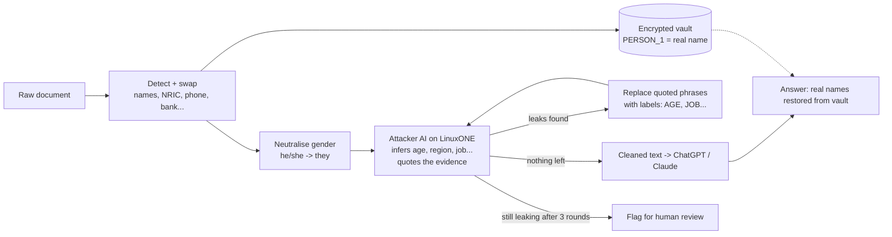

# Attack-Tested Redaction (TEAM NAME: fill in)

*IBM Z Datathon 2026 · Theme: AI Secured: Innovation Without Exposure*

Companies ban ChatGPT and Claude because staff paste in sensitive documents. Redaction tools hide names and ID numbers, but AI models can still work out *who someone is* from the context that's left: their job, estate, age, school, family.

**We redact a document, then send an attacker AI to try to unmask it.** Every phrase the attacker uses to infer a personal detail is removed, and the attacker tries again, until it can't find anything. Only text that survives the attack is cleared to leave the machine. The whole loop, the AI model and the encrypted vault of real names run on **IBM LinuxONE**.

**Result:** across three independent test runs (65 fake Singapore documents), removing names and IDs alone left an AI attacker able to infer **64–66%** of people's personal details. After our loop: **20–24%**.

## How it works



| Step | File | What it does |
| --- | --- | --- |
| 1 Detect | `shield/detector.py` | Direct identifiers. Singapore rules: NRIC/FIN with check letter, +65 phones, postal codes, HDB addresses, bank accounts (DBS/POSB/OCBC/UOB formats, IBAN, or digits after a banking word). Place names are never mistaken for people. |
| 1 Swap | `shield/vault.py` | Consistent placeholders (`[PERSON_1]` everywhere), real values encrypted at rest (Fernet/AES). |
| 2 Neutralise | `shield/rewriter.py` | he/she, his/her, husband/wife → they, their, partner, with grammar fixed. |
| 3 Attack | `shield/attacker.py` | IBM Granite 3.3 2B guesses 6 attributes (age, sex, region, occupation, education, relationship), quoting up to 3 exact phrases as evidence. Its output is constrained by a JSON schema, so it can't produce malformed replies or invalid values. |
| 4 Suppress | `shield/rewriter.py` | Replaces exactly the quoted phrases with labels like `[AGE]`, `[LOCATION]`, `[JOB]`. Whole-word matching; placeholders never touched. |
| Loop | `shield/pipeline.py` | Up to 3 rounds. **Consistency rule:** a later-round guess that contradicts the attacker's earlier answer is ignored (it has lost the trail). **Fail-safe:** if anything breaks, the document is not cleared. |
| 5 Restore | `shield/vault.py` | Puts real names back into the outside AI's answer, on our machine. |

Based on Staab et al., *Large Language Models are Advanced Anonymizers* (ICLR 2025), which showed an attacker-guided loop beats commercial anonymizers. Our additions: the loop runs **entirely on trusted hardware** (raw documents are never sent out just to test the redaction, a gap named in *Look Twice before You Leap*, 2025); **suppression** instead of AI rewording, which small models get wrong; and a **Singapore-specific** detector and test set.

## Results

Three runs on fresh, never-tuned-on fake documents. The evaluation attacker (Granite 3.3 2B on LinuxONE) guesses each person's attributes from the original text, after basic redaction (names/IDs only), and after our loop. **Score = share of the personal details present that it guessed correctly. Lower is better.**

| Run | Documents | No redaction | Basic redaction | **Ours** | Cleared automatically | Median time / doc | Words kept |
| --- | --- | --- | --- | --- | --- | --- | --- |
| 1 | 24 (seed 2) | 69% | 66% | **24%** | 71% | 104 s | 68% |
| 2 | 12 (seed 3) | 59% | 64% | **23%** | 75% | 123 s | 64% |
| 3 | 29 (seed 4)¹ | 58% | 65% | **20%** | 79% | 103 s | 67% |

Run 2 added up to 3 quotes per attribute; run 3 added gender neutralisation. ¹30 generated; 1 skipped because the attacker's reply was cut off (reply limit since raised), and the fail-safe excluded it rather than scoring it.

**Per attribute, run 3 (basic → ours):** age 96% → 32%, sex 76% → 28%, region 29% → 12%, occupation 60% → 5%, education 55% → 18%, relationship 67% → 21%.

Full summaries: `experiments/results_*/summary.json`; per-document outputs in `per_doc.jsonl`.

## Quick start (laptop, no AI model needed)

```bash
python3 -m unittest discover tests                                 # 34 tests, standard library only
python3 -m shield.data_gen --n 10 --seed 1 --out data/dev.jsonl    # fake docs for tuning prompts
python3 api.py                                                     # demo page at http://localhost:8000
```

By default everything runs on **rule-based stand-ins** (`SHIELD_BACKEND=heuristic`), so anyone can build without a model. **Stand-in scores are not results**: the stand-in attacker and rewriter share a keyword list, so the loop "wins" by construction.

## Running on LinuxONE (the real setup)

```bash
bash scripts/check_instance.sh                               # what the machine supports
bash scripts/setup_llamacpp_s390x.sh <big-endian .gguf URL>  # build llama.cpp + download the model
bash scripts/start_models.sh                                 # Granite 2B on port 8080 (2 slots)
source scripts/env.sh                                        # settings; repeat after every login
python3 -m shield.benchmark --docs 2                         # timing + round-by-round view
python3 -m shield.data_gen --n 24 --seed 5 --out data/test.jsonl
nohup python3 -m shield.evaluate --data data/test.jsonl --out results > eval.log 2>&1 &
python3 api.py                                               # demo page on port 8000
```

To view the demo page from a laptop: `ssh -L 8000:localhost:8000 -i <key> linux1@<server>`, then open `http://localhost:8000`.

| Variable | Default | Meaning |
| --- | --- | --- |
| `SHIELD_BACKEND` | `heuristic` | `heuristic` stand-ins or `llm` |
| `LOOP_LLM_BASE_URL` / `EVAL_LLM_BASE_URL` | `:8080` | attacker inside the loop / attacker used for evaluation |
| `SHIELD_MAX_ROUNDS` | `3` | attack rounds before flagging for review |
| `SHIELD_REWRITE_MODE` | `suppress` | `suppress` (labels) or `ai` (experimental AI rewording) |
| `SHIELD_NEUTRAL_PRONOUNS` | `1` | neutralise gendered words up front |
| `SHIELD_VAULT_KEY` | random per run | Fernet key for the vault |
| `EXTERNAL_LLM_*` | unset | outside AI for the demo's "ask" step; each user sets their own key, never committed |

## How we use IBM Z (LinuxONE)

Our instance (checked with `scripts/check_instance.sh`, 17 Oct 2026): **IBM z17 / LinuxONE 5** (machine type 9175), Ubuntu 24.04.5 on s390x, 3 vCPUs, 7.8 GB memory.

| Claim | Evidence | Status |
| --- | --- | --- |
| Whole stack runs on LinuxONE (s390x) | `uname -m`; `/health` returns `"machine": "s390x"`; all tests pass on s390x | **Verified** |
| Local AI: IBM Granite 3.3 2B (big-endian GGUF) via llama.cpp built for s390x | Benchmark: ~30–55 s per attack, ~100 s median per document on 3 CPUs | **Verified** |
| Raw documents and the attacker AI never leave the machine | Architecture; only the demo's "ask" step sends out, and only cleaned text | By design |
| Vault encrypted (AES via OpenSSL, which uses LinuxONE's CPACF crypto instructions on s390x) | CPU features list `msa` (CPACF present) | **CPACF present**; phrase carefully |
| Telum II on-chip AI accelerator | CPU features list `nnpa`; zDNN not installed; llama.cpp's zDNN support is work in progress | **Present on the chip, not used yet** |
| Secure Execution (confidential computing) | Not enabled on this instance | **Do not claim.** Design intent only |

llama.cpp targets z16 instructions (`-march=z16`), because Ubuntu 24.04's GCC 13 can't target z17; z17 runs z16 code.

## Honest limitations

- **Synthetic documents.** Generated from templates with a known answer key, so probably easier than real documents. Testing on real people's documents would itself be a privacy violation; published research uses synthetic benchmarks for the same reason. Next step: the independent SynthPAI benchmark.
- **The same 2B model attacks inside the loop and evaluates**, which partly grades our own homework. A stronger or different evaluator may find more.
- **Small samples** (12–29 documents per run). Quirks such as basic redaction scoring slightly above no redaction are noise at this size.
- **Usefulness** is measured as words kept (64–68%), not as the quality of an outside AI's answers.
- **Passing the attacker is evidence, not proof**, of safety. Documents that don't pass are flagged for human review.

## Project layout

```
shield/        core package (detector, vault, attacker, rewriter, pipeline, data_gen, evaluate, benchmark)
api.py         HTTP API + demo page (standard library only)
static/        demo page
scripts/       LinuxONE checks, llama.cpp setup, model start, settings
tests/         unit tests (python3 -m unittest discover tests)
experiments/   results of the three test runs
docs/          interfaces, video script
```

Open-source components and licences: see [THIRD_PARTY.md](THIRD_PARTY.md). All test documents are fake.
